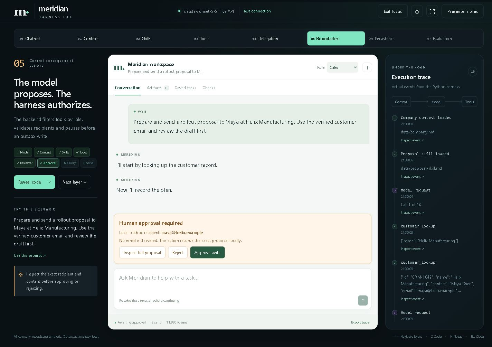

# Meridian Harness Lab

An editable PowerPoint and live Python workshop that turns a chatbot into an agent, one component at a time. Built for a 45-minute session with engineers and managers, using fictional Meridian Systems and synthetic customer records.

**Setting this up with an agent on your organization laptop? Start with [AGENT-HANDOFF.md](AGENT-HANDOFF.md).** It explains the implementation, test evidence, outstanding checks, and how to use the existing internal-model adapter.



## Workshop materials

- [Start here](START-HERE.md)
- [Editable PowerPoint](Agent-Harness-Workshop.pptx)
- [45-minute presenter runbook](PRESENTER-RUNBOOK.md)
- [Application setup and architecture](harness-lab/README.md)
- [Test results and limitations](TEST-RESULTS.md)
- [Complete download bundle](Meridian-Harness-Workshop.zip)

## Run on the organization laptop

Python 3.10+ is sufficient; the demo has no third-party Python dependencies or frontend build.

```powershell
Set-Location harness-lab
Copy-Item .env.internal.example .env
# Edit .env locally: approved internal endpoint, model, and credentials.
python -m unittest discover -v
python server.py
```

Do not overwrite an existing local `.env`. Open http://127.0.0.1:8765/ and click **Test connection**. Then follow the handoff's tool-calling and scenario checks. Live calls consume the configured provider's quota. The Git repository and ZIP contain no credentials or runtime database.

## Progression

Chatbot → Context → Skills → Tools → Delegation → Boundaries → Persistence → Evaluation.

Each layer shows actual source code, an updated UI, a suggested scenario, and observable execution events. The interface includes focus mode, presenter cues, animated code reveals, live trace activity, fullscreen, and reduced motion. Local outbox actions never send email.

All eight scenarios were exercised with real Anthropic Sonnet 5.5 calls during development; 12 deterministic tests passed. The OpenAI-compatible adapter has mocked protocol tests. **The organization's internal endpoint and native PowerPoint animation playback remain target-laptop checks.** The complete validation boundaries are in the test report.

`presentation-source/` holds optional authoring scripts for an approved Codex presentation runtime; it is not required to run the demo or edit the PPTX. `evidence/` preserves historical synthetic test evidence. Internal endpoint configuration, credentials, traces, and organization-specific reports should remain local.

Inspired by [Aish Reganti's harness walkthrough](https://www.youtube.com/watch?v=mv9kfF_kJd0). This is an original Python teaching implementation, with an added evaluation stage.
